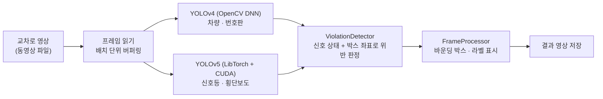

# 🚦 교차로 우회전 위반 단속 카메라

> 충북대학교 지능로봇공학과 **오픈소스개발프로젝트** · 2024.09 ~ 2024.12 · 팀 MIRI COMPANY · **팀장, 추론 아키텍처 개발**

교차로 영상에서 **차량 · 신호등 · 횡단보도**를 YOLO로 인식하고, 보행 신호가 켜진 상태에서 횡단보도를 침범하는 우회전 차량을 판별하는 단속 프로그램입니다.
학습은 Python(PyTorch)으로, 추론과 판정은 **C++ (OpenCV · LibTorch)**로 구현했고, CUDA 배치 병렬 처리로 **30FPS 이상**의 실시간 처리를 달성했습니다.

| 항목 | 내용 |
|---|---|
| 언어 | C++ (추론·판정), Python (모델 학습) |
| 모델 | YOLOv4 (Darknet) · YOLOv5 (Ultralytics) |
| 추론 | OpenCV DNN · LibTorch (TorchScript) · CUDA |
| 데이터 | AI Hub 차량 영상 데이터 · SelectStar 교차로 정보 데이터 |
| 결과 | ONNX 구동 시 10FPS 이하 → C++/LibTorch + CUDA 배치 처리로 **30FPS 이상** |

---

## 1. 왜 만들었나

운전하면서 **우회전 단속 기준이 모호하다**고 느꼈습니다. 기준을 명확히 정리한 뒤, 이를 판별하는 카메라를 직접 구현해 보며 올바른 운전 방법을 확인하는 것이 목표였습니다.

| # | 상황 | 올바른 우회전 |
|---|---|---|
| 1 | 전방 차량 신호 적색 | 일시정지 후 우회전 |
| 2 | 전방 차량 신호 녹색 | 서행하며 우회전 |
| 3 | 차량 신호 적색 + 보행자 신호 녹색 | 일시정지 후 보행자가 없으면 우회전 |
| 4 | 차량 신호 녹색 + 보행자 신호 녹색 | 일시정지, 보행자 횡단이 끝난 뒤 우회전 |
| 5 | 차량 신호 녹색 + 보행자 신호 녹색 + 보행자 없음 | 서행하며 우회전 |

## 2. 동작 흐름

1. 영상을 프레임 단위로 읽어 배치로 묶습니다.
2. 차량·번호판은 YOLOv4, 신호등·횡단보도는 YOLOv5로 탐지합니다.
3. 보행 신호(초록불)일 때 차량이 횡단보도 영역을 침범했는지 판정합니다.
4. 정상 차량은 파란 박스, 위반 차량은 빨간 박스와 문구로 표시하고 결과 영상을 저장합니다.

## 3. 모델과 데이터

| 모델 | 탐지 대상 | 학습 데이터 | 학습 도구 | C++에서 불러오는 방법 |
|---|---|---|---|---|
| YOLOv4 | 차량(차종), 번호판 | [AI Hub](https://aihub.or.kr/) 차종·연식·번호판 인식용 영상 | [Darknet](https://github.com/AlexeyAB/darknet), [Yolo_mark](https://github.com/AlexeyAB/Yolo_mark) | cfg·weight 파일을 OpenCV DNN으로 로드 |
| YOLOv5 | 신호등(색), 횡단보도 | SelectStar 교차로 정보 데이터 | [Ultralytics YOLOv5](https://github.com/ultralytics/yolov5) | `.pt` → TorchScript 변환 후 LibTorch로 로드 |

## 4. 클래스 구조

| 클래스 | 역할 |
|---|---|
| `YOLO4Model` | OpenCV DNN으로 YOLOv4 cfg·weight를 불러와, 프레임을 Blob으로 바꿔 넣고 박스·클래스를 반환 |
| `YOLO5Model` | TorchScript 모델을 불러오고 CUDA 사용 가능 여부를 확인해 GPU/CPU를 선택. 프레임을 Tensor로 바꿔 추론하고 박스·클래스를 반환 |
| `ViolationDetector` | 감지된 객체 위치와 신호 상태로 위반 여부 판단 (`Dectect_violation()`) |
| `FrameProcessor` | 감지 결과의 바운딩 박스와 라벨을 프레임에 그림 (`DrawBoxes()`) |
| `TrafficViolationSystem` | 전체 제어 — 모델·시각화·판정 객체와 배치 처리용 프레임 버퍼를 가지고, 영상을 배치 단위로 읽어 추론 → 판정 → 시각화 → 저장. 박스 좌표를 원본 프레임 크기에 맞게 스케일 변환 |

## 5. 위반 판정 알고리즘

**처음 기준** — 초록불 신호등 박스와 차량 박스의 좌표를 비교해, 차량이 신호등 위치를 넘어서면 위반으로 판단했습니다.

**최종 기준** — 신호등이 **초록불**일 때, **횡단보도 박스의 좌우 범위 안에 차량 박스의 양 끝 좌표가 들어오면 위반**으로 판단합니다.

정상 차량은 파란 박스, 위반 차량은 빨간 박스와 "위반" 문구로 표시합니다.

차량이 횡단보도를 가리면 그 순간 횡단보도가 인식되지 않아 판정이 끊겼습니다. 그래서 **횡단보도가 안 보이는 프레임에서는 직전 횡단보도 박스 값을 유지**해 판정을 이어 가도록 고쳤습니다.

## 6. 실시간 처리 최적화

| 단계 | 문제 | 해결 |
|---|---|---|
| ONNX 변환 | 학습한 `.pt` 모델을 ONNX로 바꿔 C++에서 돌리자 **메모리가 초과되고 10FPS 아래**로 떨어져 영상이 끊김 | 모델을 줄이면 정확도가 떨어지므로 연산 구조에서 병목을 찾음 |
| 추론 런타임 재구축 | CPU 한 장씩 처리하는 구조의 한계 | PyTorch JIT로 TorchScript 변환 → **LibTorch 기반 C++ 추론**, **CUDA로 프레임을 배치 단위 병렬 처리** |
| 박스 위치 어긋남 | 배치 처리 후 바운딩 박스가 실제 객체 위치와 밀림 | 입력 해상도와 텐서 좌표의 **스케일 변환 기준을 다시 정의** |
| 결과 | | 모델을 줄이지 않고 **30FPS 이상** 실시간 처리 |

## 7. 개발 일정 (제안서 기준)

| 월 | 내용 |
|---|---|
| 9월 | 주제 선정, 계획서 작성, 공공 데이터 탐색, 동작 시나리오와 클래스 설계 |
| 10월 | 횡단보도·신호등 좌표를 직접 입력해 판단하는 방식으로 우선 구현, 차량·신호등·횡단보도 인식용 데이터 준비 |
| 11월 | 공공 데이터로 신호등·횡단보도 학습, 번호판 인식으로 차량 구분 |
| 12월 | 신호등·횡단보도·차량 인식을 통합한 위반 판정 완성, 발표 |

## 8. 한계와 개선 방향
- 버스·트럭에 신호등이 가려지는 경우를 대비해 신호 주기를 학습하는 방법
- 위반 차량 정보(번호판, 시각)를 외부 파일로 저장
- 녹화 영상뿐 아니라 실시간 카메라 스트림 처리

## 9. 코드 구성 · 실행 방법

> 코드 업로드 후 보완 예정입니다.

---

### 관련 저장소
- [hospital_robot_ws](https://github.com/bananabus6907/hospital_robot_ws) — YOLO 사람 인식을 활용한 자율주행 휠체어 (졸업작품)
